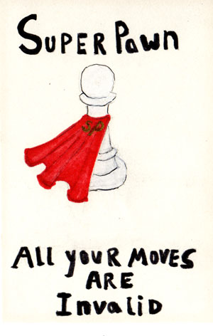

Superpawn
=========

Superpawn is a chess engine. It speaks the Universal Chess Interface, so it
plays inside any chess GUI, and it evaluates positions with a neural network
that it trained on its own games.

It is free software under the GNU Affero General Public License, version 3 or
later. If you run it as a service over a network, the licence requires you to
offer your users its source. See [LICENSE](LICENSE).

What it is
----------

A chess engine has two jobs: look ahead through the tree of possible moves,
and judge the positions it reaches. Superpawn does both the way the strongest
engines of the 2020s do.

**Search.** An alpha-beta search over bitboards, with iterative deepening,
aspiration windows, a transposition table shared between threads without
locks, and the full modern set of pruning, reduction and extension
techniques: null move, late move reductions, futility, history-based
ordering and pruning, singular extensions, ProbCut. Several threads search
the same tree at once (Lazy SMP) and vote on the result.

**Evaluation.** An efficiently updatable neural network (NNUE): 768 inputs
per side describing where the pieces stand, 1024 hidden neurons per
perspective, eight output neurons chosen by how much material is left. The
network's first layer is updated incrementally as moves are made and unmade,
so evaluating a position costs a few hundred nanoseconds. The weights are
16-bit integers evaluated with AVX-512, AVX2 or plain C++ depending on the
CPU.

**Training.** The engine generates its own training data by playing itself,
the network is trained with [bullet](https://github.com/jw1912/bullet) on a
GPU, and each new network must beat the previous one in a statistical test
before it is adopted. Every network in the engine's history was produced
this way; none comes from another engine.

The previous Superpawn, an object-oriented engine written to be read rather
than to win, is preserved on the `feature/old` branch. Nothing from it
survives in the current code.

Getting it
----------

Builds for Linux, macOS and Windows are produced by the continuous
integration workflow for every commit and attached to the workflow run under
Actions. The current network is downloaded and embedded at build time, so a
binary needs nothing else.

To build it yourself you need CMake 3.21 or newer and a C++23 compiler:
GCC 13, Clang 17 or Visual Studio 2022 17.8 and later.

    cmake -S . -B build -DCMAKE_BUILD_TYPE=Release
    cmake --build build --parallel
    ./build/superpawn

The build downloads the network named in `nets/NETWORK` from this
repository's `nets` release and verifies its checksum. Without network
access it prints a warning and builds with a simple hand-crafted evaluation
instead, which plays far weaker chess.

CMake options:

| Option           | Default              | Meaning |
|------------------|----------------------|---------|
| `SP_ARCH`        | `x86-64-v3`          | Target CPU: `x86-64-v3` (AVX2, any x86 CPU since about 2015), `x86-64-v4` (AVX-512), `x86-64` (any 64-bit x86), `native` (this machine), or `none`. Non-x86 hosts default to `none`. |
| `SP_USE_PEXT`    | `OFF`                | Use the BMI2 PEXT instruction for sliding piece attacks. Faster on Intel and AMD Zen 3 and later, slower on Zen 1 and 2. |
| `SP_EMBED_NET`   | `nets/default.nnue`  | Network file to embed. A file at this path overrides the released network; `OFF` embeds nothing. |
| `SP_LTO`         | `ON`                 | Link-time optimisation. |
| `SP_BUILD_TESTS` | `ON`                 | Build the unit tests. |
| `SP_WERROR`      | `OFF`                | Treat compiler warnings as errors. |

Using it
--------

Point a UCI-compatible GUI at the binary: Cute Chess, Arena, Banksia,
En Croissant, or any other. The engine accepts these UCI options:

| Option          | Default      | Meaning |
|-----------------|--------------|---------|
| `Threads`       | 1            | Search threads. Use the number of physical cores. |
| `Hash`          | 16           | Transposition table size in megabytes. |
| `Clear Hash`    |              | Button: empty the transposition table. |
| `MultiPV`       | 1            | Report this many best lines. |
| `Move Overhead` | 10           | Milliseconds reserved per move for GUI and network latency. |
| `EvalFile`      | `<embedded>` | Path to a network file to use instead of the embedded one. |

On a console the engine also understands a few commands of its own:

    bench [hash] [threads] [depth]   search a fixed set of positions; the node count identifies the search
    perft <depth>                    count the leaf nodes of the legal move tree
    d                                print the board
    eval                             print the static evaluation
    datagen <file> [options]         generate training data by self-play
    convert <quantised.bin> <file>   convert a bullet export into a network file
    evalstats <file> [n]             compare evaluations against stored search scores

Developing it
-------------

The architecture is described in [doc/design.md](doc/design.md). The unit tests run
in about a second:

    ctest --test-dir build --output-on-failure

They cover the bitboard primitives, position handling and hashing, the perft
suite including the standard edge cases for en passant, castling and
promotion, the NNUE code against a scalar reference and incremental updates
against full recomputation, and a few searches that must find short mates.
Debug builds also verify the position after every move.

Changes to the search or the evaluation are accepted on the result of a
Sequential Probability Ratio Test, not on judgement:

    tools/sprt/sprt.sh --base origin/main

builds both versions, fetches fastchess and an opening book on first use and
plays until the result is decided. [doc/testing.md](doc/testing.md)
gives the time controls and bounds. A network is trained and tested with the
pipeline in [doc/training.md](doc/training.md). Code is formatted
with `clang-format` using the repository's configuration.

Credits
-------

Superpawn is written by John Byrd and contributors. The logo is by Angela M.
Eads. The engine stands on ideas shared freely by the computer chess
community: the search techniques trace back through Stockfish and its
predecessors, the NNUE evaluation to Yu Nasu's work and the engines that
developed it, and the training tools to Jamie Whiting's bullet.
